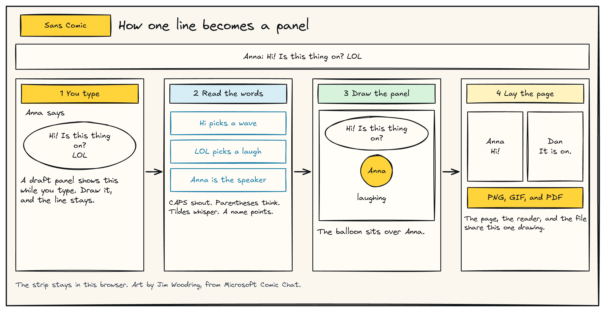

# Sans Comic

Type a line, get a comic panel. Sans Comic turns a conversation into a comic strip, the way
Microsoft Comic Chat did in 1996: the words choose each character's expression, gesture and
speech balloon, and the panels lay themselves out.



It uses the original characters and backdrops drawn by Jim Woodring, taken from the
[Comic Chat source](https://github.com/microsoft/comic-chat) that Microsoft released under the
MIT License. The name tips its hat to Comic Sans, the typeface first designed for Comic Chat.

It is a static site: plain HTML, CSS and JavaScript, with no build step and no server.
The picture above is also stored as
[how-a-line-becomes-a-panel.excalidraw](docs/diagrams/how-a-line-becomes-a-panel.excalidraw)
and [SVG](docs/diagrams/how-a-line-becomes-a-panel.svg).

## What it does

- **31 characters and 9 backdrops** from the original, with every mood and gesture each one has.
- **Auto-posing.** `LOL` laughs, `Hi` waves, CAPS shout, `(parentheses)` think, `*stars*` narrate,
  `~tildes~` whisper. Say a cast member's name and your character turns and points at them.
- **Slash commands.** Type `/` for gestures, `/roll 2d6`, `/flip`, and `/fx KABOOM` sound effects.
- **Live preview.** The line you are typing appears in the strip as a draft panel.
- **Pickers made from the art.** Choose a mood, gesture or balloon from the character's own drawings.
- **Look.** Halftone, solid colour or your own photo as a backdrop; four lettering hands; plain,
  rough or no panel frame; panels per row; name tags.
- **My comics.** Every strip saves itself in the browser. Paste a chat log to turn it into a strip.
- **Read.** A full-screen reader that reveals balloons one at a time.
- **Export.** PNG, animated GIF, PDF, a project file you can reopen, or the plain script. On a phone, Share sends the picture to Messages, Photos, or Files.
- **Backup.** My comics can be saved as one file and opened again later, on this browser or another.
- **Take turns.** With two or more people in the cast, each drawn line hands the next line to the next character.
- **Auto character.** Turn on Auto beside the cast. Start a line with `Name:` and that character says it, joining the cast when there is room. A name later in the line still points. Take turns keeps rotating when the line has no name.
- **Writing desk.** Narrow, then minimize, the bottom composer so the strip gets the room. The line box and Draw it stay where they are.

## Screens

The page is one column on a phone, a strip over a wide composer on a tablet-sized portrait, and a
strip beside the composer on a short landscape screen.

| Screen | CSS pixels | What you get |
|---|---|---|
| iPhone 18 Pro Max, portrait | 440 by 956 | Title on its own row. Composer docked under the strip. Moods open over the strip. |
| iPhone 18 Pro Max, landscape | 956 by 440 | Strip on the left, composer on the right. |
| iPhone Duo, folded | 382 by 580, and 678 by 340 | Cover width hides the title in the bar (it stays in More). Landscape keeps one short composer row. |
| iPhone Duo, unfolded | 669 by 825, and 951 by 543 | Portrait keeps the desk composer. Landscape splits on the hinge when the browser reports two viewport segments. |
| Desktop | 1100 and up, tall window | Wider strip, up to 1280px, with the mood tray open. |

Look, My comics and Undo live in the More sheet until the window is at least 840px wide.

## Run it

Serve the folder with any static web server and open it:

```sh
python3 -m http.server 8000
# then visit http://localhost:8000
```

Opening `index.html` straight from disk mostly works, but browsers block image export from
`file://` pages, so use a server.

## Run it in Docker

The image is nginx serving this folder on port 8080. Comics stay in the browser. The container
does not store them.

```sh
docker compose up -d --build
# then visit http://localhost:8080
```

The comic maker is published at [comic.tinyinternet.company](https://comic.tinyinternet.company).

## Put it on GitHub Pages

1. Push this folder to a repository.
2. In the repository, go to **Settings, Pages**, choose **Deploy from a branch**, pick `main` and `/ (root)`.
3. The comic maker is served at `https://<your-name>.github.io/<repository>/`.

## What stays on this machine

- Lettering lives in `fonts/`: Bricolage Grotesque, Comic Neue, Patrick Hand, Caveat Brush and
  Special Elite, under the SIL Open Font License. The page falls back to system fonts if a file is missing.
- GIF and PDF export use copies of [gifenc](https://github.com/mattdesl/gifenc) 1.0.3 and
  [jsPDF](https://github.com/parallax/jsPDF) 4.2.1 in `vendor/`. Refresh them with
  `npm install` and `npm run vendor`. `npm run vendor:check` fails if those copies drift.
- A character's sprite sheet loads when that character joins the cast, appears in a panel, or is auditioned.
  Portraits for the cast chips come from one shared sheet, `art/faces.png`.

Drawing, lettering and export do not need a network connection. A shared room still needs a room
service from the page host. What the page stores is written at
`privacy.html`. The source repository is
[Manaiakalani/sans-comic](https://github.com/Manaiakalani/sans-comic).

## Draw together

`room.js` lets several people write one strip live. It relies on a room service provided by the
page's host: it works when the app runs as a Claude artifact, and stays hidden everywhere else,
including GitHub Pages. To offer rooms on your own site, give `window.claude.use('room')` an
object with the same `join`, `emit`, `on`, `presence` and `onPeers` calls, backed by your own
WebSocket relay.

## How the code is laid out

| File | What it holds |
|---|---|
| `index.html`, `app.css`, `favicon.svg`, `apple-touch-icon.png`, `share.png`, `privacy.html` | The page, its styles, the icons, the link preview, and the privacy note |
| `engine.js` | Reads the words, picks poses, lays out panels, draws them |
| `app.js` | The strip view, composer, pickers, sheets and saved comics |
| `share.js` | PNG, GIF, PDF, project file and script export |
| `reader.js` | The full-screen reader |
| `room.js` | Draw together |
| `manifest.js` | Where each drawing sits in the sprite sheets, generated by the build script |
| `art/` | One sprite sheet per character, portraits, backdrops |
| `fonts/` | The five lettering families, as woff2 |
| `vendor/` | gifenc and jsPDF, copied from `node_modules` |
| `tools/` | Art rebuild, the vendor refresh, and `engine.test.mjs` |
| `docs/diagrams/` | The README drawing |

The comic is a pure function of the script: a strip is a list of lines plus a few style
settings, and `FP.layoutStrip(strip)` turns that into panels. The editor, reader, exports and
thumbnails all draw through that one path. A strip keeps at most six characters in the cast.

The layout engine is new, written from the rules described in the original's source and in the
SIGGRAPH '96 paper *Comic Chat* by Kurlander, Skelly and Salesin. It is not a port of the C++.

## Rebuild the art

The art in `art/` is extracted from the original `.avb` and `.bgb` files and smoothed to twice
the size. To regenerate it:

```sh
git clone https://github.com/microsoft/comic-chat
pip install pillow numpy
python3 tools/build_art.py --source comic-chat --out .
```

This reproduces the shipped files exactly. `tools/avb.py` is a small reader for the Comic Chat
art formats. Pillow and numpy are only for that offline rebuild.

## Credits and licence

- Code: MIT, see [LICENSE](LICENSE). Copyright (c) 2026 Maximilian Stein.
- Characters and backdrops: drawn by Jim Woodring for Microsoft Comic Chat. Copyright (c) Microsoft
  Corporation, MIT License, see [art/LICENSE-Microsoft.txt](art/LICENSE-Microsoft.txt).
- Fonts: Comic Neue, Bricolage Grotesque, Patrick Hand, Caveat Brush and Special Elite, in
  [fonts/](fonts/fonts.css), under the SIL Open Font License.

This is an unofficial fan project and is not affiliated with Microsoft.
